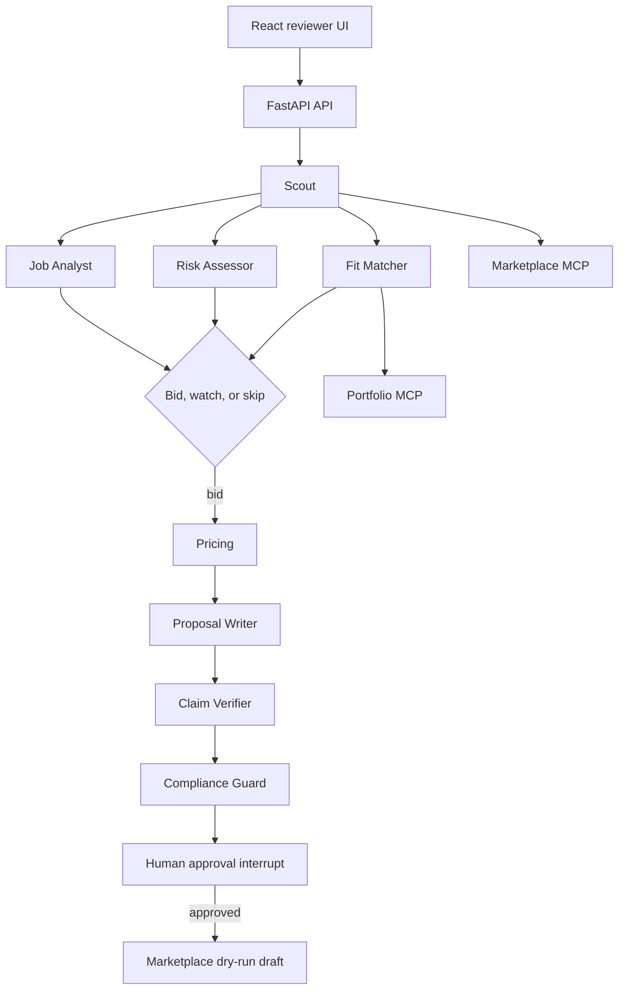

# Architecture

## Design objective

GigBid is designed around a simple rule: the system can recommend and draft, but a person authorises every external action. The code separates transient run state, audit events, and future long-term memory so one does not accidentally become another.

## Runtime flow

## State discipline

The models in `agent/handoffs.py` are the boundary between roles: `JobSpec`, `RiskReport`, `FitReport`, `PriceQuote`, `Decision`, `ProposalDraft`, and `ClaimCheck`. This is intentionally more reviewable than a long free-text transcript.

- **Run state** holds the current job, analyses, draft, and status.
- **Execution trace** is appended for an API call or tool event and should be masked before persistence.
- **Long-term memory** is not enabled in the demo. A production promotion rule should write only explicit user edit preferences or verified outcome aggregates, never raw job text or tool output.

## Deployment profiles

`demo` mode uses only the checked-in synthetic JSON. It is suitable for reviewing functionality. `live` mode remains blocked until the owner configures the official Upwork MCP connection, OAuth storage, tenant isolation, and audited rate limiting. The graph talks to `MarketplacePort`, so switching adapters does not change agent code.

## Failure handling

The UI gives a visible marketplace-unavailable banner on failed API reads. Marketplace writes use idempotency keys in the adapter. A production build should add Redis-backed queues, PostgreSQL checkpoints, retry/backoff policies, and a dead-letter dashboard before enabling live operations.

